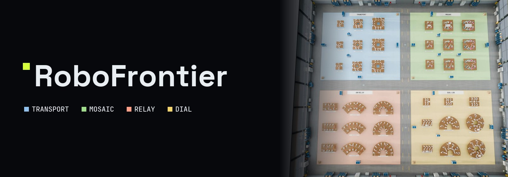

<div align="center">



# RoboFrontier

**Can language models run a robot world?**

Language-model agents in charge of up to sixteen robot arms in Robo World, a physical
simulation: 36 tasks, four families, 24-hour runs.

[**Project page**](https://changxuanfan.github.io/RoboFrontier/) ·
[**Watch the film**](https://changxuanfan.github.io/RoboFrontier/#film) ·
[**Tasks**](docs/tasks/README.md) ·
[**Getting started**](docs/getting-started.md)

[](LICENSE)
[](LICENSE-DATA.md)
[](pyproject.toml)

</div>

<!-- media:film -->

https://github.com/user-attachments/assets/f73e9736-0fe3-456d-a1c2-a753678abc4f

<!-- /media:film -->

## What it is

RoboFrontier asks language-model agents to **organize, communicate and collaborate**
across many robot arms. Every model drives the same simulated Franka arms through the
same robot tool, sees the same cameras and follows the same rules. Nothing is scripted:
who does what, when to wait, how to talk and how to recover are the agent's choices.

| | |
| --- | --- |
| **Agents** | Native Codex and Claude Code sessions. A Controller owns the task and, in the adaptive protocol, forks delegates for bounded jobs and takes their arms back. |
| **One robot tool** | Move arms and grippers, batch and pre-check motions, observe from named cameras, wait for events, message teammates, delegate and hand work back. Every call and its outcome is recorded. |
| **Robo World** | MuJoCo dynamics with real contacts and simulated Franka Panda arms. Grasps slip, timbers swing, springs push back; no teleporting, state writes or resets. |
| **Scoring** | Success is judged on the final world state; failures, retries, time, tokens, collisions and parallelism are reported beside it. |

## Four task families

Each family has nine tasks: three team sizes crossed with three difficulty levels.
The videos below are **Oracle** reference runs rendered in Robo World: privileged programs
that read hidden task state. They show that each task can be done; they are not model
results. The Mosaic 6- and 8-arm runs and `dial-best5-n08-d3` were operator-assisted;
Transport and Mosaic were recorded on revision R13, before the released physics revision;
the Relay runs are historical runs whose completion was confirmed by review. Idle time is
removed and playback is sped up. Each montage plays all nine tasks of a family at once:
rows are difficulty levels 1–3, columns are team sizes.

### 🟦 Transport — deliver ordered items to their boards

4, 8 and 12 arms · 12–36 targets · L1 release on the board · L2 blades into fixed blind
slots · L3 a spring-mounted moving board.

<!-- media:montage-transport -->

https://github.com/user-attachments/assets/6224985c-da54-4098-9066-18fc0c023712

<!-- /media:montage-transport -->

### 🟩 Mosaic — fill a color pattern with distinct cubes

4, 6 and 8 arms · 72–288 cells · L1 pockets guide each cube · L2 printed grid lines
· L3 no visible grid.

<!-- media:montage-mosaic -->

https://github.com/user-attachments/assets/07e18688-2711-4835-a474-398f504023ea

<!-- /media:montage-mosaic -->

### 🟧 Relay — carry long timbers arm to arm

8, 12 and 16 arms · 2–4 timbers · L1 straight timber · L2 a 63-degree arc with a pendant
· L3 a deflected timber on passive springs.

<!-- media:montage-relay -->

https://github.com/user-attachments/assets/d786c4b1-1cde-4034-b195-56546a41e8ee

<!-- /media:montage-relay -->

### 🟨 Dial — crack a hidden code with spring dials

4, 6 and 8 dials on 4–16 arms · L1 fixed modules · L2 lift each module with support and
grasp · L3 lifted modules with an eccentric crank. A BEST display shows only the best
match count so far.

<!-- media:montage-dial -->

https://github.com/user-attachments/assets/f4abfc06-8e7c-433a-bc16-aa3cb9df9641

<!-- /media:montage-dial -->

<details>
<summary><b>All 36 tasks, one by one</b> — select a task to watch its full run, front and side</summary>

<!-- gallery -->
<b>Transport</b>

<table><tr><th></th><th>4 arms</th><th>8 arms</th><th>12 arms</th></tr><tr><th>L1</th><td><a href="https://changxuanfan.github.io/RoboFrontier/#task=transport-a04-d1"></a><br><sub>transport-a04-d1</sub></td><td><a href="https://changxuanfan.github.io/RoboFrontier/#task=transport-a08-d1"></a><br><sub>transport-a08-d1</sub></td><td><a href="https://changxuanfan.github.io/RoboFrontier/#task=transport-a12-d1"></a><br><sub>transport-a12-d1</sub></td></tr><tr><th>L2</th><td><a href="https://changxuanfan.github.io/RoboFrontier/#task=transport-a04-d2"></a><br><sub>transport-a04-d2</sub></td><td><a href="https://changxuanfan.github.io/RoboFrontier/#task=transport-a08-d2"></a><br><sub>transport-a08-d2</sub></td><td><a href="https://changxuanfan.github.io/RoboFrontier/#task=transport-a12-d2"></a><br><sub>transport-a12-d2</sub></td></tr><tr><th>L3</th><td><a href="https://changxuanfan.github.io/RoboFrontier/#task=transport-a04-d3"></a><br><sub>transport-a04-d3</sub></td><td><a href="https://changxuanfan.github.io/RoboFrontier/#task=transport-a08-d3"></a><br><sub>transport-a08-d3</sub></td><td><a href="https://changxuanfan.github.io/RoboFrontier/#task=transport-a12-d3"></a><br><sub>transport-a12-d3</sub></td></tr></table>

<b>Mosaic</b>

<table><tr><th></th><th>4 arms</th><th>6 arms</th><th>8 arms</th></tr><tr><th>L1</th><td><a href="https://changxuanfan.github.io/RoboFrontier/#task=mosaic-a04-6x12-d1"></a><br><sub>mosaic-a04-6x12-d1</sub></td><td><a href="https://changxuanfan.github.io/RoboFrontier/#task=mosaic-a06-9x18-d1"></a><br><sub>mosaic-a06-9x18-d1</sub></td><td><a href="https://changxuanfan.github.io/RoboFrontier/#task=mosaic-a08-12x24-d1"></a><br><sub>mosaic-a08-12x24-d1</sub></td></tr><tr><th>L2</th><td><a href="https://changxuanfan.github.io/RoboFrontier/#task=mosaic-a04-6x12-d2"></a><br><sub>mosaic-a04-6x12-d2</sub></td><td><a href="https://changxuanfan.github.io/RoboFrontier/#task=mosaic-a06-9x18-d2"></a><br><sub>mosaic-a06-9x18-d2</sub></td><td><a href="https://changxuanfan.github.io/RoboFrontier/#task=mosaic-a08-12x24-d2"></a><br><sub>mosaic-a08-12x24-d2</sub></td></tr><tr><th>L3</th><td><a href="https://changxuanfan.github.io/RoboFrontier/#task=mosaic-a04-6x12-d3"></a><br><sub>mosaic-a04-6x12-d3</sub></td><td><a href="https://changxuanfan.github.io/RoboFrontier/#task=mosaic-a06-9x18-d3"></a><br><sub>mosaic-a06-9x18-d3</sub></td><td><a href="https://changxuanfan.github.io/RoboFrontier/#task=mosaic-a08-12x24-d3"></a><br><sub>mosaic-a08-12x24-d3</sub></td></tr></table>

<b>Relay</b>

<table><tr><th></th><th>8 arms</th><th>12 arms</th><th>16 arms</th></tr><tr><th>L1</th><td><a href="https://changxuanfan.github.io/RoboFrontier/#task=relay-a08-d1"></a><br><sub>relay-a08-d1</sub></td><td><a href="https://changxuanfan.github.io/RoboFrontier/#task=relay-a12-d1"></a><br><sub>relay-a12-d1</sub></td><td><a href="https://changxuanfan.github.io/RoboFrontier/#task=relay-a16-d1"></a><br><sub>relay-a16-d1</sub></td></tr><tr><th>L2</th><td><a href="https://changxuanfan.github.io/RoboFrontier/#task=relay-a08-d2"></a><br><sub>relay-a08-d2</sub></td><td><a href="https://changxuanfan.github.io/RoboFrontier/#task=relay-a12-d2"></a><br><sub>relay-a12-d2</sub></td><td><a href="https://changxuanfan.github.io/RoboFrontier/#task=relay-a16-d2"></a><br><sub>relay-a16-d2</sub></td></tr><tr><th>L3</th><td><a href="https://changxuanfan.github.io/RoboFrontier/#task=relay-a08-d3"></a><br><sub>relay-a08-d3</sub></td><td><a href="https://changxuanfan.github.io/RoboFrontier/#task=relay-a12-d3"></a><br><sub>relay-a12-d3</sub></td><td><a href="https://changxuanfan.github.io/RoboFrontier/#task=relay-a16-d3"></a><br><sub>relay-a16-d3</sub></td></tr></table>

<b>Dial</b>

<table><tr><th></th><th>4 dials</th><th>6 dials</th><th>8 dials</th></tr><tr><th>L1</th><td><a href="https://changxuanfan.github.io/RoboFrontier/#task=dial-best5-n04-d1"></a><br><sub>dial-best5-n04-d1</sub></td><td><a href="https://changxuanfan.github.io/RoboFrontier/#task=dial-best5-n06-d1"></a><br><sub>dial-best5-n06-d1</sub></td><td><a href="https://changxuanfan.github.io/RoboFrontier/#task=dial-best5-n08-d1"></a><br><sub>dial-best5-n08-d1</sub></td></tr><tr><th>L2</th><td><a href="https://changxuanfan.github.io/RoboFrontier/#task=dial-best5-n04-d2"></a><br><sub>dial-best5-n04-d2</sub></td><td><a href="https://changxuanfan.github.io/RoboFrontier/#task=dial-best5-n06-d2"></a><br><sub>dial-best5-n06-d2</sub></td><td><a href="https://changxuanfan.github.io/RoboFrontier/#task=dial-best5-n08-d2"></a><br><sub>dial-best5-n08-d2</sub></td></tr><tr><th>L3</th><td><a href="https://changxuanfan.github.io/RoboFrontier/#task=dial-best5-n04-d3"></a><br><sub>dial-best5-n04-d3</sub></td><td><a href="https://changxuanfan.github.io/RoboFrontier/#task=dial-best5-n06-d3"></a><br><sub>dial-best5-n06-d3</sub></td><td><a href="https://changxuanfan.github.io/RoboFrontier/#task=dial-best5-n08-d3"></a><br><sub>dial-best5-n08-d3</sub></td></tr></table>
<!-- /gallery -->

</details>

## How a run works


All benchmark runs use the **adaptive** protocol: one Controller reads the task, keeps
the plan and either drives arms itself or forks a delegate for a bounded job, which hands
its arms back with `return_task`. We compare it with three fixed organizations on the
same tasks:

| Mode | Organization |
| --- | --- |
| `single` | One Controller drives every arm. |
| `controller-worker` | A coordinating Controller and one permanent Worker per arm. |
| `worker-worker` | One Worker per arm; Workers coordinate as peers. |
| `adaptive` | One Controller that creates and retires delegates as it sees fit. |

Each run gets 24 hours from its START; reading, planning and waiting count. Benchmark
results, the communication study and the skills study are on the
[project page](https://changxuanfan.github.io/RoboFrontier/#results).

## Quick start

Python 3.12, [uv](https://docs.astral.sh/uv/), Node.js and the native CLI of the engine
you select.

```sh
uv sync --locked --extra oracle
.venv/bin/robofrontier bootstrap   # restore the pinned task assets, hash-verified
.venv/bin/robofrontier doctor      # check the CLI, sandbox and renderer
.venv/bin/robofrontier plan        # what would run; no model calls
```

Preparing and running a batch make real, billable model calls only after an explicit
preflight. [Getting started](docs/getting-started.md) covers configuration, running,
monitoring, data handoff, Oracle runs and Robo World rendering (the `factory` commands);
[docs/](docs/README.md) has every guide.

| Path | What is there |
| --- | --- |
| [`benchmark/`](benchmark/README.md) | The 36 released tasks and `release.json` |
| [`robofrontier/`](robofrontier) | Simulation, native hosts, runtime protocol, evidence |
| [`prompts/`](prompts) | Every text a model reads: rules, roles, skills |
| [`site/`](site/DESIGN.md) | The project page |
| [`docs/`](docs/README.md) | Guides by topic and dated history |

## Citation

```bibtex
@misc{robofrontier2026,
  title  = {RoboFrontier: Benchmarking How LLM Agents Organize,
            Communicate, and Collaborate in a Multi-Robot World},
  author = {Fan, Changxuan and others},
  year   = {2026},
  url    = {https://github.com/changxuanfan/RoboFrontier}
}
```

First author: **Changxuan Fan**, Hong Kong University of Science and Technology. The
remaining author list, publication status and paper URL are not finalized.

## License

Code is under the [MIT License](LICENSE). Benchmark data and media (task and scene data,
rendered images, Robo World scene assets and published videos) are under
[CC BY 4.0](LICENSE-DATA.md). Third-party material keeps its own license: the Franka Panda
model from MuJoCo Menagerie (Apache 2.0), the Barlow Condensed, Space Grotesk and JetBrains
Mono fonts (OFL 1.1) and a Poly Haven texture (CC0); see [`LICENSE-DATA.md`](LICENSE-DATA.md).
