<div align="center">

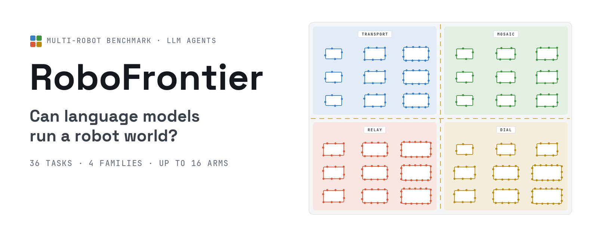

**Can Multimodal Agents Work Together on Long Physical Tasks?**

[Project page](https://changxuanfan.github.io/RoboFrontier/) ·
[Film](https://changxuanfan.github.io/RoboFrontier/#film) ·
[Tasks](docs/tasks/README.md) ·
[Getting started](docs/getting-started.md)

[](LICENSE)
[](LICENSE-DATA.md)
[](pyproject.toml)

<a href="https://changxuanfan.github.io/RoboFrontier/#film">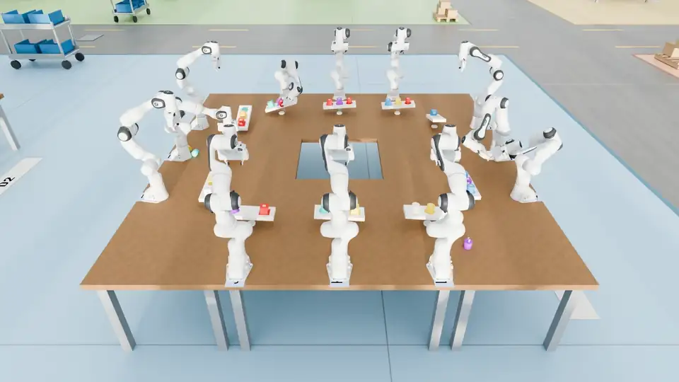</a>

<sub>One moment from each zone of Robo World. Oracle reference runs, not model results. Select to watch the full film.</sub>

</div>

## What it is

RoboFrontier asks multimodal agents to **organize, communicate and collaborate**
across many robot arms. Every model drives the same simulated Franka arms through the
same robot tool, sees the same cameras and follows the same rules. Nothing is scripted:
who does what, when to wait, how to talk and how to recover are the agent's choices.

| | |
| --- | --- |
| **Agents** | Native Codex and Claude Code sessions. A Controller owns the task and, in the adaptive protocol, forks delegates for bounded jobs and takes their arms back. |
| **One robot tool** | Move arms and grippers, batch and pre-check motions, observe from named cameras, wait for events, message teammates, delegate and hand work back. Every call and its outcome is recorded. |
| **Robo World** | MuJoCo dynamics with real contacts and simulated Franka Panda arms. Grasps slip, timbers swing, springs push back; no teleporting, state writes or resets. |
| **Scoring** | Success is judged on the final world state; failures, retries, time, tokens, collisions and parallelism are reported beside it. |

## Four task families

Each family has nine tasks: three team sizes crossed with three difficulty levels. A larger
team brings more arms and more work; a higher level changes the physics of the job itself.

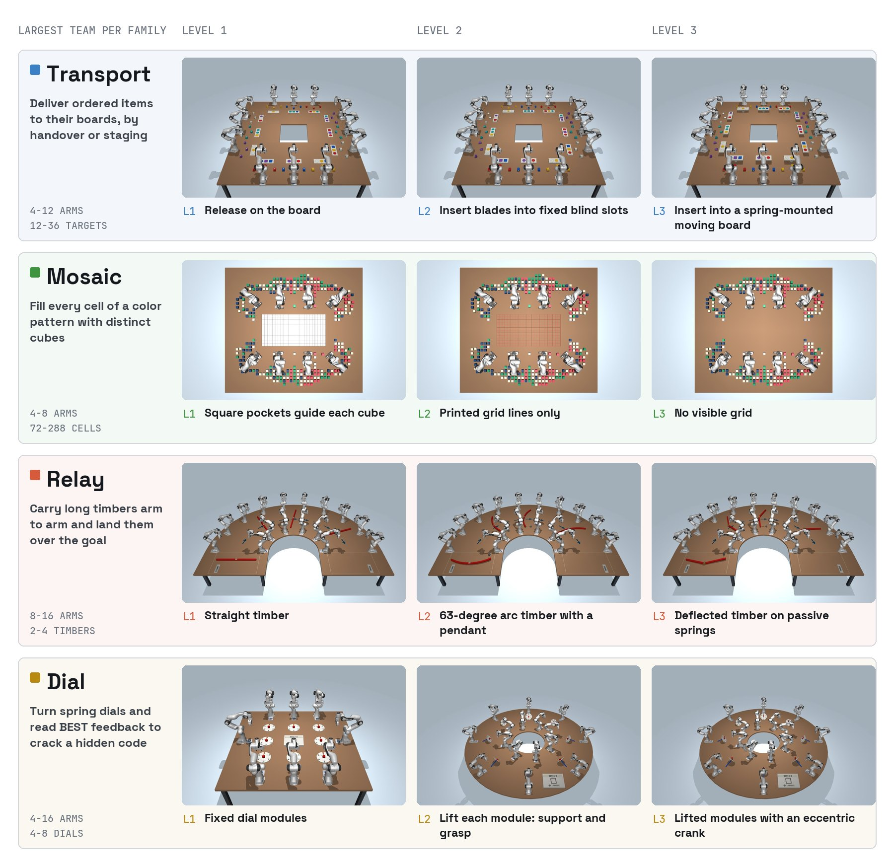

<sub>Initial states of the largest team of each family at Levels 1–3.</sub>

The videos below are **Oracle** reference runs rendered in Robo World: privileged programs
that read hidden task state. They show that each task can be done; they are not model
results. The Mosaic 6- and 8-arm runs and `dial-best5-n08-d3` were operator-assisted;
Transport and Mosaic were recorded with the scenes' earlier physics settings, not the
released ones; the Relay runs' completion was confirmed by review. Idle time is removed and
playback is sped up. Each montage plays all nine tasks of a family at once:
rows are difficulty levels 1–3, columns are team sizes.

### 🟦 Transport — deliver ordered items to their boards

4, 8 and 12 arms · 12–36 targets · L1 release on the board · L2 blades into fixed blind
slots · L3 a spring-mounted moving board.

<!-- media:montage-transport -->

https://github.com/user-attachments/assets/6224985c-da54-4098-9066-18fc0c023712

<!-- /media:montage-transport -->

### 🟩 Mosaic — fill a color pattern with distinct cubes

4, 6 and 8 arms · 72–288 cells · L1 pockets guide each cube · L2 printed grid lines
· L3 no visible grid.

<!-- media:montage-mosaic -->

https://github.com/user-attachments/assets/07e18688-2711-4835-a474-398f504023ea

<!-- /media:montage-mosaic -->

### 🟧 Relay — carry long timbers arm to arm

8, 12 and 16 arms · 2–4 timbers · L1 straight timber · L2 a 63-degree arc with a pendant
· L3 a deflected timber on passive springs.

<!-- media:montage-relay -->

https://github.com/user-attachments/assets/d786c4b1-1cde-4034-b195-56546a41e8ee

<!-- /media:montage-relay -->

### 🟨 Dial — crack a hidden code with spring dials

4, 6 and 8 dials on 4–16 arms · L1 fixed modules · L2 lift each module with support and
grasp · L3 lifted modules with an eccentric crank. A BEST display shows only the best
match count so far.

<!-- media:montage-dial -->

https://github.com/user-attachments/assets/f4abfc06-8e7c-433a-bc16-aa3cb9df9641

<!-- /media:montage-dial -->

<details>
<summary><b>All 36 tasks, one by one</b> — select a task to watch its full run, front and side</summary>

<!-- gallery -->
<b>Transport</b>

<table><tr><th></th><th>4 arms</th><th>8 arms</th><th>12 arms</th></tr><tr><th>L1</th><td><a href="https://changxuanfan.github.io/RoboFrontier/#task=transport-a04-d1">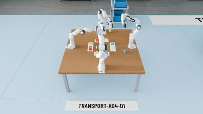</a><br><sub>transport-a04-d1</sub></td><td><a href="https://changxuanfan.github.io/RoboFrontier/#task=transport-a08-d1">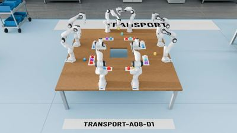</a><br><sub>transport-a08-d1</sub></td><td><a href="https://changxuanfan.github.io/RoboFrontier/#task=transport-a12-d1">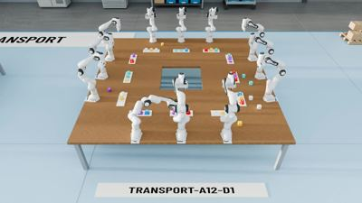</a><br><sub>transport-a12-d1</sub></td></tr><tr><th>L2</th><td><a href="https://changxuanfan.github.io/RoboFrontier/#task=transport-a04-d2">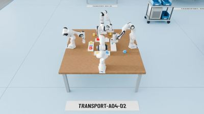</a><br><sub>transport-a04-d2</sub></td><td><a href="https://changxuanfan.github.io/RoboFrontier/#task=transport-a08-d2">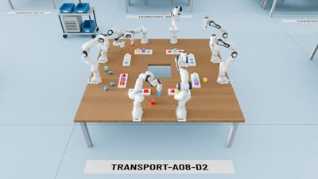</a><br><sub>transport-a08-d2</sub></td><td><a href="https://changxuanfan.github.io/RoboFrontier/#task=transport-a12-d2">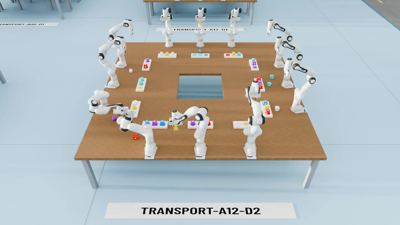</a><br><sub>transport-a12-d2</sub></td></tr><tr><th>L3</th><td><a href="https://changxuanfan.github.io/RoboFrontier/#task=transport-a04-d3">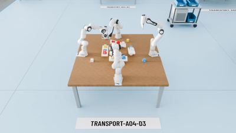</a><br><sub>transport-a04-d3</sub></td><td><a href="https://changxuanfan.github.io/RoboFrontier/#task=transport-a08-d3">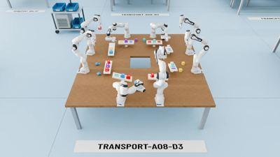</a><br><sub>transport-a08-d3</sub></td><td><a href="https://changxuanfan.github.io/RoboFrontier/#task=transport-a12-d3">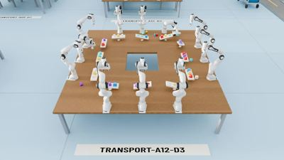</a><br><sub>transport-a12-d3</sub></td></tr></table>

<b>Mosaic</b>

<table><tr><th></th><th>4 arms</th><th>6 arms</th><th>8 arms</th></tr><tr><th>L1</th><td><a href="https://changxuanfan.github.io/RoboFrontier/#task=mosaic-a04-6x12-d1">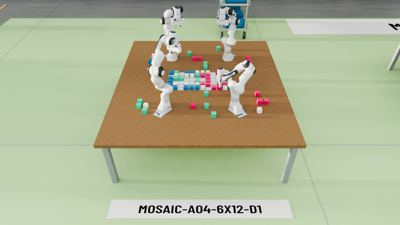</a><br><sub>mosaic-a04-6x12-d1</sub></td><td><a href="https://changxuanfan.github.io/RoboFrontier/#task=mosaic-a06-9x18-d1">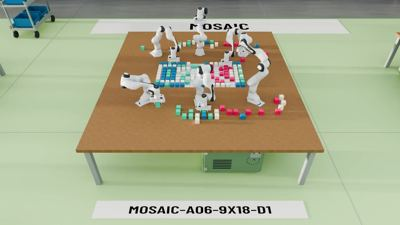</a><br><sub>mosaic-a06-9x18-d1</sub></td><td><a href="https://changxuanfan.github.io/RoboFrontier/#task=mosaic-a08-12x24-d1">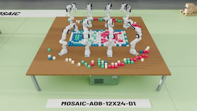</a><br><sub>mosaic-a08-12x24-d1</sub></td></tr><tr><th>L2</th><td><a href="https://changxuanfan.github.io/RoboFrontier/#task=mosaic-a04-6x12-d2">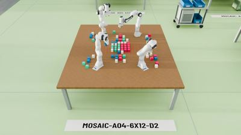</a><br><sub>mosaic-a04-6x12-d2</sub></td><td><a href="https://changxuanfan.github.io/RoboFrontier/#task=mosaic-a06-9x18-d2">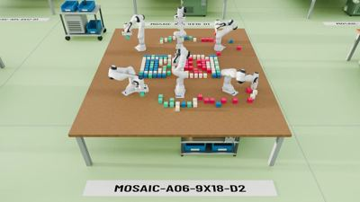</a><br><sub>mosaic-a06-9x18-d2</sub></td><td><a href="https://changxuanfan.github.io/RoboFrontier/#task=mosaic-a08-12x24-d2">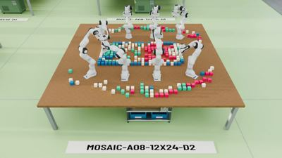</a><br><sub>mosaic-a08-12x24-d2</sub></td></tr><tr><th>L3</th><td><a href="https://changxuanfan.github.io/RoboFrontier/#task=mosaic-a04-6x12-d3">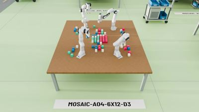</a><br><sub>mosaic-a04-6x12-d3</sub></td><td><a href="https://changxuanfan.github.io/RoboFrontier/#task=mosaic-a06-9x18-d3">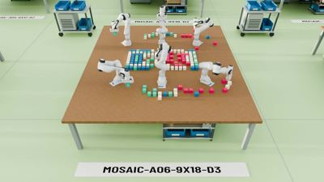</a><br><sub>mosaic-a06-9x18-d3</sub></td><td><a href="https://changxuanfan.github.io/RoboFrontier/#task=mosaic-a08-12x24-d3">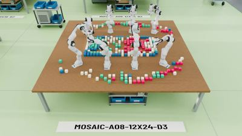</a><br><sub>mosaic-a08-12x24-d3</sub></td></tr></table>

<b>Relay</b>

<table><tr><th></th><th>8 arms</th><th>12 arms</th><th>16 arms</th></tr><tr><th>L1</th><td><a href="https://changxuanfan.github.io/RoboFrontier/#task=relay-a08-d1">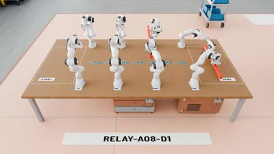</a><br><sub>relay-a08-d1</sub></td><td><a href="https://changxuanfan.github.io/RoboFrontier/#task=relay-a12-d1">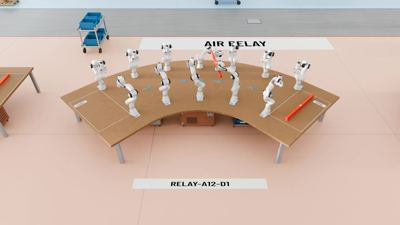</a><br><sub>relay-a12-d1</sub></td><td><a href="https://changxuanfan.github.io/RoboFrontier/#task=relay-a16-d1">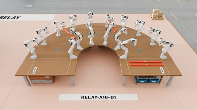</a><br><sub>relay-a16-d1</sub></td></tr><tr><th>L2</th><td><a href="https://changxuanfan.github.io/RoboFrontier/#task=relay-a08-d2">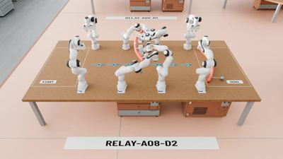</a><br><sub>relay-a08-d2</sub></td><td><a href="https://changxuanfan.github.io/RoboFrontier/#task=relay-a12-d2">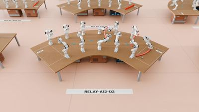</a><br><sub>relay-a12-d2</sub></td><td><a href="https://changxuanfan.github.io/RoboFrontier/#task=relay-a16-d2">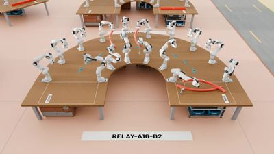</a><br><sub>relay-a16-d2</sub></td></tr><tr><th>L3</th><td><a href="https://changxuanfan.github.io/RoboFrontier/#task=relay-a08-d3">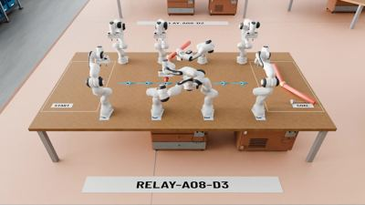</a><br><sub>relay-a08-d3</sub></td><td><a href="https://changxuanfan.github.io/RoboFrontier/#task=relay-a12-d3">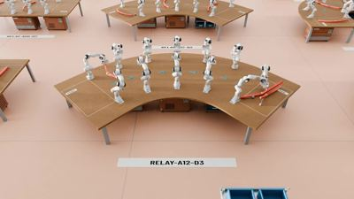</a><br><sub>relay-a12-d3</sub></td><td><a href="https://changxuanfan.github.io/RoboFrontier/#task=relay-a16-d3">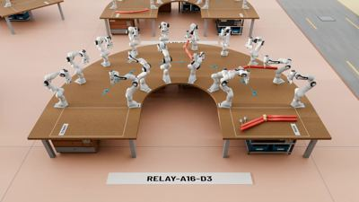</a><br><sub>relay-a16-d3</sub></td></tr></table>

<b>Dial</b>

<table><tr><th></th><th>4 dials</th><th>6 dials</th><th>8 dials</th></tr><tr><th>L1</th><td><a href="https://changxuanfan.github.io/RoboFrontier/#task=dial-best5-n04-d1">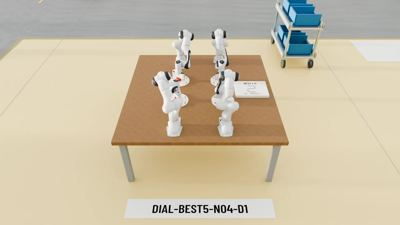</a><br><sub>dial-best5-n04-d1</sub></td><td><a href="https://changxuanfan.github.io/RoboFrontier/#task=dial-best5-n06-d1">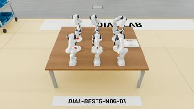</a><br><sub>dial-best5-n06-d1</sub></td><td><a href="https://changxuanfan.github.io/RoboFrontier/#task=dial-best5-n08-d1">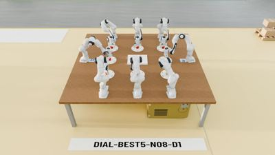</a><br><sub>dial-best5-n08-d1</sub></td></tr><tr><th>L2</th><td><a href="https://changxuanfan.github.io/RoboFrontier/#task=dial-best5-n04-d2">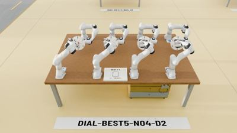</a><br><sub>dial-best5-n04-d2</sub></td><td><a href="https://changxuanfan.github.io/RoboFrontier/#task=dial-best5-n06-d2">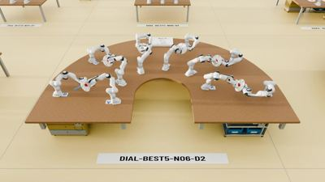</a><br><sub>dial-best5-n06-d2</sub></td><td><a href="https://changxuanfan.github.io/RoboFrontier/#task=dial-best5-n08-d2">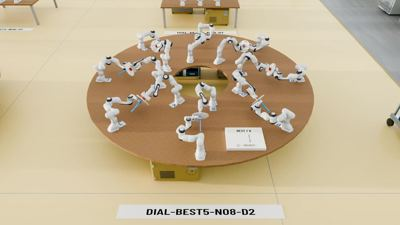</a><br><sub>dial-best5-n08-d2</sub></td></tr><tr><th>L3</th><td><a href="https://changxuanfan.github.io/RoboFrontier/#task=dial-best5-n04-d3">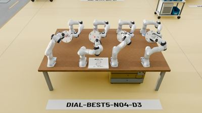</a><br><sub>dial-best5-n04-d3</sub></td><td><a href="https://changxuanfan.github.io/RoboFrontier/#task=dial-best5-n06-d3">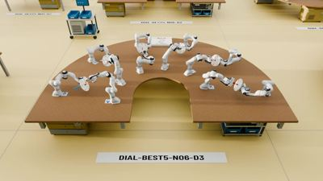</a><br><sub>dial-best5-n06-d3</sub></td><td><a href="https://changxuanfan.github.io/RoboFrontier/#task=dial-best5-n08-d3">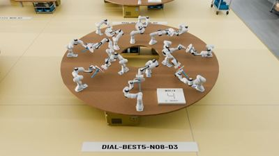</a><br><sub>dial-best5-n08-d3</sub></td></tr></table>
<!-- /gallery -->

</details>

## How a run works

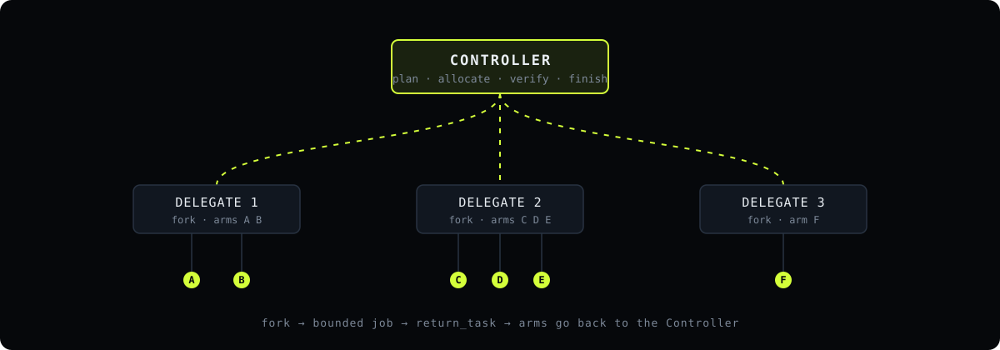

All benchmark runs use the **adaptive** protocol: one Controller reads the task, keeps
the plan and either drives arms itself or forks a delegate for a bounded job, which hands
its arms back with `return_task`. We compare it with three fixed organizations on the
same tasks:

| Mode | Organization |
| --- | --- |
| `single` | One Controller drives every arm. |
| `controller-worker` | A coordinating Controller and one permanent Worker per arm. |
| `worker-worker` | One Worker per arm; Workers coordinate as peers. |
| `adaptive` | One Controller that creates and retires delegates as it sees fit. |

Each run gets 24 hours from its START; reading, planning and waiting count. Benchmark
results, the communication study and the skills study are on the
[project page](https://changxuanfan.github.io/RoboFrontier/#results).

## Getting started

### 1. What you need

| | |
| --- | --- |
| **Host** | macOS on Apple silicon, Linux with an NVIDIA GPU or CPU only, a Slurm cluster, a RunPod pod or Docker. Each has a guide in [docs/running/](docs/README.md). |
| **Software** | Python 3.12, [uv](https://docs.astral.sh/uv/), Node.js, `ffmpeg`, and the CLI of the engine you run: Claude Code 2.1.316 (`claude`) or Codex 0.165.0 (`codex`). Other versions are refused. |
| **Linux sandbox** | `bwrap` and `socat` where user namespaces work; otherwise Linux 6.7 or newer (Landlock ABI 4) with `libseccomp`. |
| **A model account** | A Claude subscription token, or an API key for one of the profiles in [`configs/models.json`](configs/models.json). |

### 2. Install

```sh
git clone https://github.com/changxuanfan/RoboFrontier.git
cd RoboFrontier
uv sync --locked --extra oracle
.venv/bin/robofrontier bootstrap
```

`bootstrap` downloads the pinned task assets and checks every file against its hash.

### 3. Credentials

```sh
cp .env.example .env
chmod 600 .env
```

Fill in only the variable your profile reads, for example `CLAUDE_CODE_OAUTH_TOKEN` (from
`claude setup-token`) for the Claude subscription profiles, or `OPENAI_API_KEY` for Codex's
`luna`. Keep credentials in `.env`, not exported in the shell: runs load it themselves and
hand the Claude token to the CLI on a pipe, so no policy shell can read it.

### 4. Choose what to run

Defaults are in [`robofrontier.toml`](robofrontier.toml): Codex with `luna`, the adaptive
protocol, all 36 tasks, and a renderer picked for the host. Change them with options or a
small TOML of your own, passed before the command (`robofrontier --config site.toml ...`);
[`configs/examples/`](configs/examples) has one for the Mac, RunPod and Slurm.

```sh
.venv/bin/robofrontier doctor --engine claude                  # CLI version, sandbox, renderer, credentials
.venv/bin/robofrontier plan --engine claude --families relay --level 1
```

`plan` lists each task, its arms and the model, and makes no model calls.

### 5. Build and check the policy environment

Every run gives the model its own frozen Python environment, closed off from the rest of the
host. Build it once per host, in a folder outside your home folder and the repository, then
check that its sandbox holds:

```sh
.venv/bin/python -m scripts.build_policy_env --base /Users/Shared/robofrontier   # prints its root
.venv/bin/python -m scripts.check_policy_env /Users/Shared/robofrontier/policy-env-<id>
```

On macOS that base is the default. On Linux pick one (outside `/tmp`) and set
`ROBOFRONTIER_POLICY_ENV_BASE` to it in the shell that prepares runs. The check starts each
engine's real CLI against a local stub, with no model calls, and tries about 50 things a policy
must and must not be able to do; `prepare` refuses an environment that has not passed it.
[Policy environment](docs/running/policy-environment.md) covers what each platform allows.

### 6. Preflight, then run

```sh
.venv/bin/robofrontier preflight --engine claude --confirm-spend --max-budget-usd 1
.venv/bin/robofrontier prepare --engine claude --families relay --level 1 --output runs/policy/claude-relay-l1
.venv/bin/robofrontier run runs/policy/claude-relay-l1
.venv/bin/robofrontier status runs/policy/claude-relay-l1
```

- `preflight` makes a few small, paid calls to confirm the model and CLI behave as the harness
  needs; a run is refused without its passed receipt.
- `prepare` freezes the code, the task inputs, the profile and the configuration into a new
  folder. Nothing in it changes afterwards.
- `run` on macOS hands the batch to launchd and returns, so it outlives the terminal; on Linux
  add `--durable` for the same. Each run has 24 hours of active time from its START and is
  scored then, or when the model finishes.
- `stop` ends a batch in order. A run that stopped unexpectedly continues by itself once;
  `robofrontier continue` continues stopped runs by hand, as the same trials.

Each run's results, videos and evidence stay in the batch folder; when the batch ends they are
also collected into `runs/exports/<batch>-<hash>/` and a verified ZIP beside it (the runs root
is `paths.runs_root`, default `runs/`). [Getting started](docs/getting-started.md) goes through each step in detail;
[docs/](docs/README.md) has every guide.

| Path | What is there |
| --- | --- |
| [`benchmark/`](benchmark/README.md) | The 36 released tasks and `release.json` |
| [`robofrontier/`](robofrontier) | Simulation, engine hosts, runtime protocol, evidence |
| [`prompts/`](prompts) | Every text a model reads: rules, roles, skills |
| [`configs/`](configs/README.md) | Model profiles, harness settings, pinned asset archives, examples |
| [`site/`](site/DESIGN.md) | The project page |
| [`docs/`](docs/README.md) | Guides by topic, and the project history |

## Citation

```bibtex
@misc{robofrontier2026,
  title  = {RoboFrontier: Can Multimodal Agents Work Together on Long
            Physical Tasks?},
  author = {Fan, Changxuan and others},
  year   = {2026},
  url    = {https://github.com/changxuanfan/RoboFrontier}
}
```

First author: **Changxuan Fan**, Hong Kong University of Science and Technology. The
remaining author list, publication status and paper URL are not finalized.

## License

Code is under the [MIT License](LICENSE). Benchmark data and media (task and scene data,
rendered images, Robo World scene assets and published videos) are under
[CC BY 4.0](LICENSE-DATA.md). Third-party material keeps its own license: the Franka Panda
model from MuJoCo Menagerie (Apache 2.0), the Barlow Condensed, Space Grotesk and JetBrains
Mono fonts (OFL 1.1) and a Poly Haven texture (CC0); see [`LICENSE-DATA.md`](LICENSE-DATA.md).
