<div align="center">

# RoboTeam

**Benchmarking Vision-Based Multi-Agent Control of Many Robot Arms in Real Time**

[Project page](https://changxuanfan.github.io/RoboTeam/) ·
[Tasks](docs/tasks/README.md) ·
[Getting started](docs/getting-started.md) ·
[Docs](docs/README.md)

[](LICENSE)
[](LICENSE-DATA.md)
[](pyproject.toml)

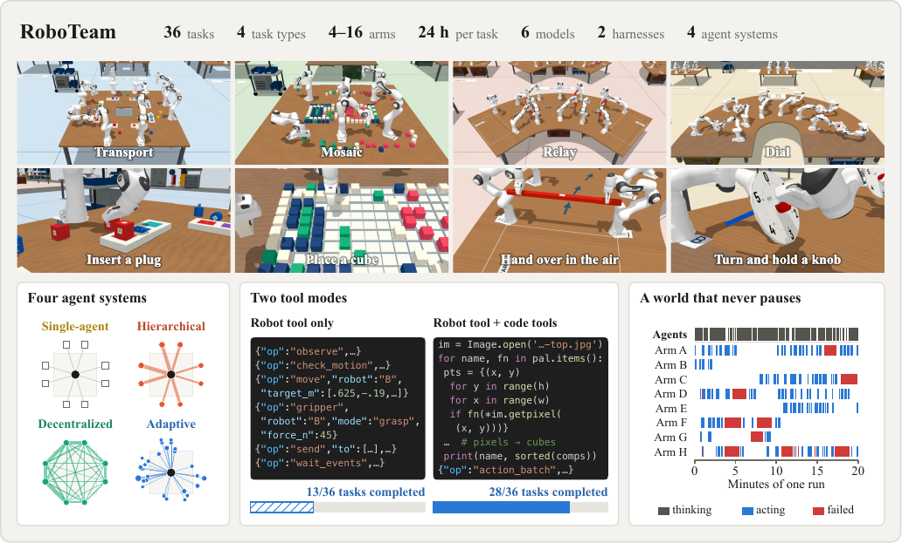

</div>

## What it is

RoboTeam is a simulated benchmark where multimodal agents control **4 to 16 robot arms in
real time from camera images alone**. Its 36 tasks are long jobs that the arms must do
together, such as passing timbers or building a picture from hundreds of cubes.

| | |
| --- | --- |
| **Real time** | The world advances with the clock and never waits for an agent. It runs in MuJoCo with a 2 ms physics step. |
| **Vision only** | Agents get RGB images from fixed cameras (1280 × 800) and the state of the arms. They never receive object positions, depth or contacts. |
| **One robot tool** | Arms move only through one tool with simple commands: move an arm to a pose, or open, close or grasp with a gripper. Every failed motion or grasp is visible. |
| **Code tools** | Unless a condition removes them, agents also have a shell, file editing and their own Python code, inside a sandbox that keeps them away from the simulator and the evaluator. |
| **Long runs** | A run ends when the agents declare the task done or after 24 hours of active time. Agents may fail and retry. |

## Tasks

Four task types, each at three team sizes and three difficulty levels. Team size adds arms and
work to divide. Difficulty makes the same job physically or visually harder.

<div align="center">
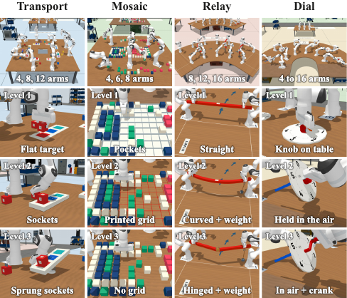
</div>

| Task type | The job | Arms | Level 1 → 2 → 3 |
| --- | --- | --- | --- |
| **Transport** | Deliver every item to its target board | 4, 8, 12 | Flat targets → sockets → sockets on a sprung board |
| **Mosaic** | Build a reference picture from colored cubes | 4, 6, 8 | Pockets → printed lines → unmarked cells |
| **Relay** | Move long timbers to a goal, handing over in the air | 8, 12, 16 | Straight → curved with a hanging weight → hinged with a hanging weight |
| **Dial** | Find a hidden code by turning and holding spring-loaded knobs | 4 to 16 | Knobs on the table → modules held in the air → cranks |

Each task type has [its own guide](docs/tasks/README.md), and the 36 cases are in
[`benchmark/`](benchmark/README.md).

## Agent systems

| Agent system | Organization |
| --- | --- |
| `adaptive` | One Controller that forks delegates, hands them arms and takes the arms back. |
| `single-agent` | One agent controls every arm. |
| `hierarchical` | One Worker per arm under a Controller. |
| `decentralized` | One Worker per arm and no Controller; Workers coordinate directly. |

Agents run in a coding-agent harness, either Codex or Claude Code. In both, they get the same
robot tool, instructions, camera images and sandbox, and they can write lessons to one shared
skill file that starts empty in every run.

## Results

<div align="center">
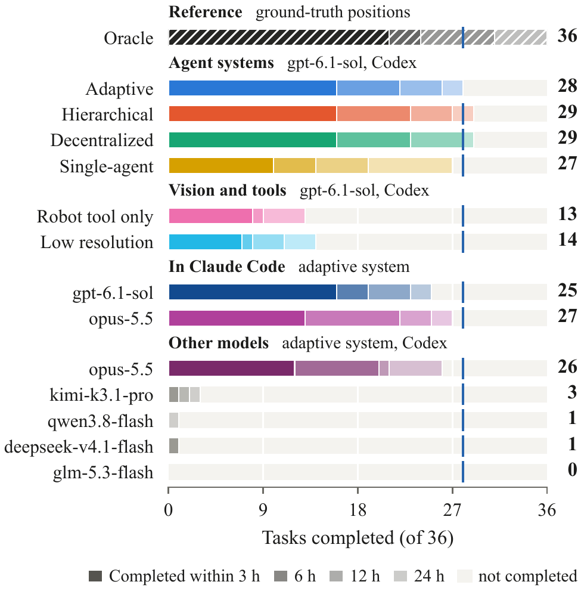
</div>

- **The best models complete most tasks, but at a high price.** With the adaptive system,
  gpt-6.1-sol and opus-5.5 complete 28 and 27 of the 36 tasks, and four other models at most 3.
  A typical task takes gpt-6.1-sol 3.5 hours and 218 million input tokens, and 34% of its
  atomic steps fail at least once and must be retried.
- **Other agent systems trade time for tokens.** The four systems complete a similar number of
  tasks. The hierarchical and decentralized systems are faster than the adaptive system but use
  1.9 and 1.7 times its tokens, and the single agent uses fewer tokens but takes 1.6 times as long.
- **What limits the agents is recovering positions from images.** Given ground-truth object
  positions (the Oracle), gpt-6.1-sol completes all 36 tasks. With low-resolution images it
  completes 14, and without code tools 13.

No model or agent system is yet fast, cheap and reliable at once.

## Videos

The videos below are **Oracle** reference runs: gpt-6.1-sol in Codex as a single agent, given
the ground-truth position of every object instead of camera images. They show that each task
can be done; some recordings were operator-assisted or made on earlier scene revisions, as the
note on each video on the project page says ([`site/data/oracle-videos.json`](site/data/oracle-videos.json)). Idle time is removed and
playback is sped up. Each montage plays all nine tasks of
a task type at once: rows are Levels 1 to 3, columns are team sizes. Runs of every model are on
the [project page](https://changxuanfan.github.io/RoboTeam/).

### Transport

<!-- media:montage-transport -->

https://github.com/user-attachments/assets/6224985c-da54-4098-9066-18fc0c023712

<!-- /media:montage-transport -->

### Mosaic

<!-- media:montage-mosaic -->

https://github.com/user-attachments/assets/07e18688-2711-4835-a474-398f504023ea

<!-- /media:montage-mosaic -->

### Relay

<!-- media:montage-relay -->

https://github.com/user-attachments/assets/d786c4b1-1cde-4034-b195-56546a41e8ee

<!-- /media:montage-relay -->

### Dial

<!-- media:montage-dial -->

https://github.com/user-attachments/assets/f4abfc06-8e7c-433a-bc16-aa3cb9df9641

<!-- /media:montage-dial -->

<details>
<summary><b>All 36 tasks, one by one</b> — select a task to watch its full run, front and side</summary>

<!-- gallery -->
<b>Transport</b>

<table><tr><th></th><th>4 arms</th><th>8 arms</th><th>12 arms</th></tr><tr><th>L1</th><td><a href="https://changxuanfan.github.io/RoboTeam/#task=transport-a04-d1">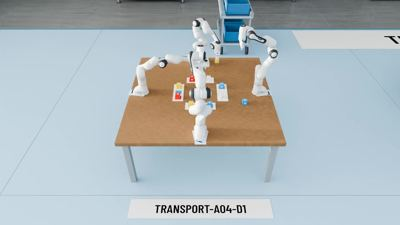</a><br><sub>transport-a04-d1</sub></td><td><a href="https://changxuanfan.github.io/RoboTeam/#task=transport-a08-d1">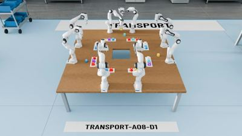</a><br><sub>transport-a08-d1</sub></td><td><a href="https://changxuanfan.github.io/RoboTeam/#task=transport-a12-d1">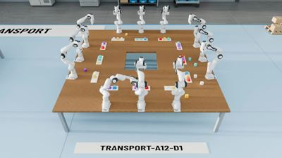</a><br><sub>transport-a12-d1</sub></td></tr><tr><th>L2</th><td><a href="https://changxuanfan.github.io/RoboTeam/#task=transport-a04-d2">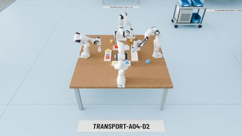</a><br><sub>transport-a04-d2</sub></td><td><a href="https://changxuanfan.github.io/RoboTeam/#task=transport-a08-d2">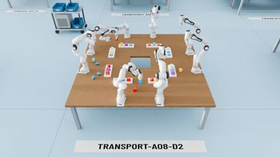</a><br><sub>transport-a08-d2</sub></td><td><a href="https://changxuanfan.github.io/RoboTeam/#task=transport-a12-d2">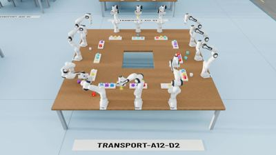</a><br><sub>transport-a12-d2</sub></td></tr><tr><th>L3</th><td><a href="https://changxuanfan.github.io/RoboTeam/#task=transport-a04-d3">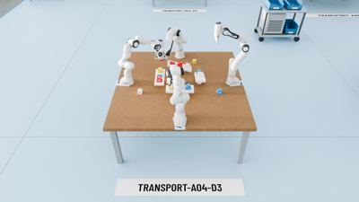</a><br><sub>transport-a04-d3</sub></td><td><a href="https://changxuanfan.github.io/RoboTeam/#task=transport-a08-d3">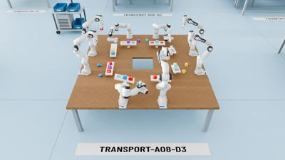</a><br><sub>transport-a08-d3</sub></td><td><a href="https://changxuanfan.github.io/RoboTeam/#task=transport-a12-d3">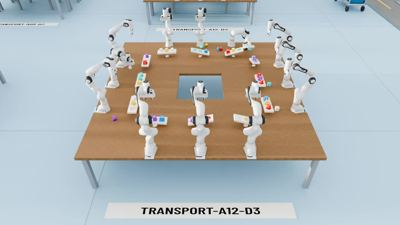</a><br><sub>transport-a12-d3</sub></td></tr></table>

<b>Mosaic</b>

<table><tr><th></th><th>4 arms</th><th>6 arms</th><th>8 arms</th></tr><tr><th>L1</th><td><a href="https://changxuanfan.github.io/RoboTeam/#task=mosaic-a04-6x12-d1">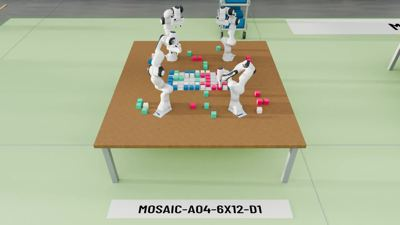</a><br><sub>mosaic-a04-6x12-d1</sub></td><td><a href="https://changxuanfan.github.io/RoboTeam/#task=mosaic-a06-9x18-d1">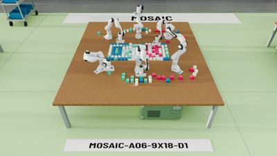</a><br><sub>mosaic-a06-9x18-d1</sub></td><td><a href="https://changxuanfan.github.io/RoboTeam/#task=mosaic-a08-12x24-d1">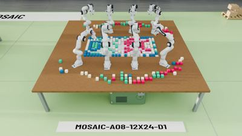</a><br><sub>mosaic-a08-12x24-d1</sub></td></tr><tr><th>L2</th><td><a href="https://changxuanfan.github.io/RoboTeam/#task=mosaic-a04-6x12-d2">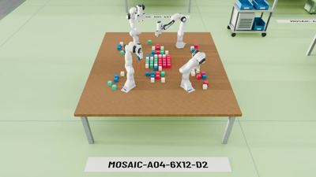</a><br><sub>mosaic-a04-6x12-d2</sub></td><td><a href="https://changxuanfan.github.io/RoboTeam/#task=mosaic-a06-9x18-d2">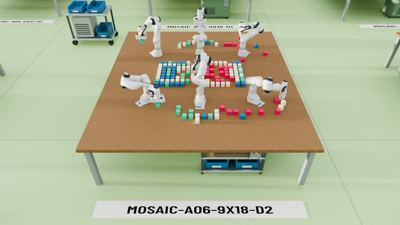</a><br><sub>mosaic-a06-9x18-d2</sub></td><td><a href="https://changxuanfan.github.io/RoboTeam/#task=mosaic-a08-12x24-d2">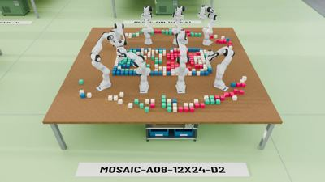</a><br><sub>mosaic-a08-12x24-d2</sub></td></tr><tr><th>L3</th><td><a href="https://changxuanfan.github.io/RoboTeam/#task=mosaic-a04-6x12-d3">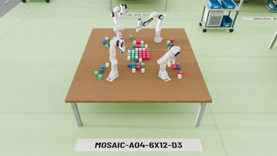</a><br><sub>mosaic-a04-6x12-d3</sub></td><td><a href="https://changxuanfan.github.io/RoboTeam/#task=mosaic-a06-9x18-d3">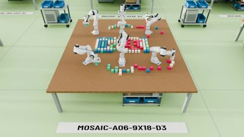</a><br><sub>mosaic-a06-9x18-d3</sub></td><td><a href="https://changxuanfan.github.io/RoboTeam/#task=mosaic-a08-12x24-d3">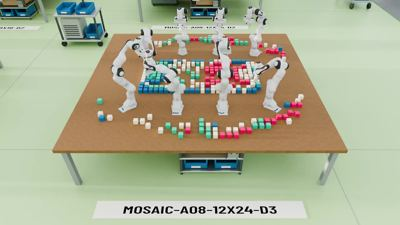</a><br><sub>mosaic-a08-12x24-d3</sub></td></tr></table>

<b>Relay</b>

<table><tr><th></th><th>8 arms</th><th>12 arms</th><th>16 arms</th></tr><tr><th>L1</th><td><a href="https://changxuanfan.github.io/RoboTeam/#task=relay-a08-d1">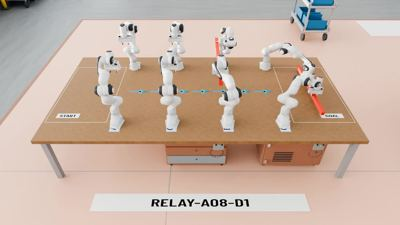</a><br><sub>relay-a08-d1</sub></td><td><a href="https://changxuanfan.github.io/RoboTeam/#task=relay-a12-d1">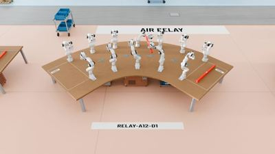</a><br><sub>relay-a12-d1</sub></td><td><a href="https://changxuanfan.github.io/RoboTeam/#task=relay-a16-d1">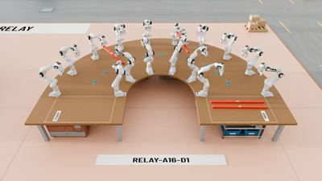</a><br><sub>relay-a16-d1</sub></td></tr><tr><th>L2</th><td><a href="https://changxuanfan.github.io/RoboTeam/#task=relay-a08-d2">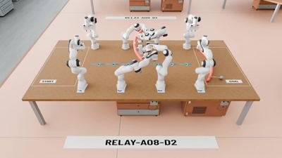</a><br><sub>relay-a08-d2</sub></td><td><a href="https://changxuanfan.github.io/RoboTeam/#task=relay-a12-d2">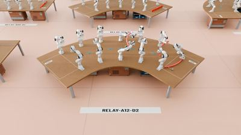</a><br><sub>relay-a12-d2</sub></td><td><a href="https://changxuanfan.github.io/RoboTeam/#task=relay-a16-d2">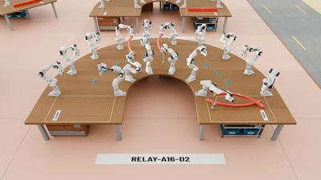</a><br><sub>relay-a16-d2</sub></td></tr><tr><th>L3</th><td><a href="https://changxuanfan.github.io/RoboTeam/#task=relay-a08-d3">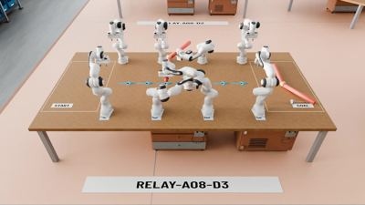</a><br><sub>relay-a08-d3</sub></td><td><a href="https://changxuanfan.github.io/RoboTeam/#task=relay-a12-d3">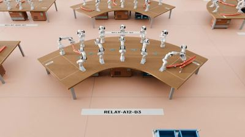</a><br><sub>relay-a12-d3</sub></td><td><a href="https://changxuanfan.github.io/RoboTeam/#task=relay-a16-d3">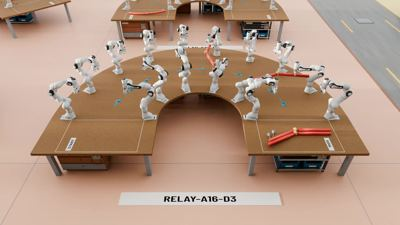</a><br><sub>relay-a16-d3</sub></td></tr></table>

<b>Dial</b>

<table><tr><th></th><th>4 dials</th><th>6 dials</th><th>8 dials</th></tr><tr><th>L1</th><td><a href="https://changxuanfan.github.io/RoboTeam/#task=dial-best5-n04-d1">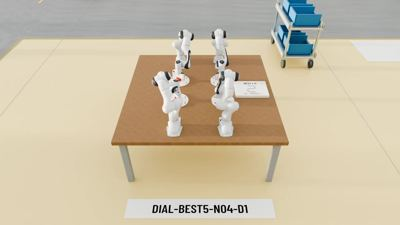</a><br><sub>dial-best5-n04-d1</sub></td><td><a href="https://changxuanfan.github.io/RoboTeam/#task=dial-best5-n06-d1">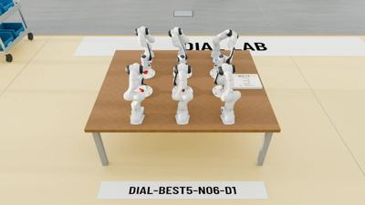</a><br><sub>dial-best5-n06-d1</sub></td><td><a href="https://changxuanfan.github.io/RoboTeam/#task=dial-best5-n08-d1">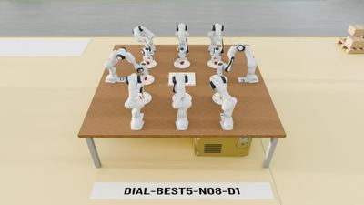</a><br><sub>dial-best5-n08-d1</sub></td></tr><tr><th>L2</th><td><a href="https://changxuanfan.github.io/RoboTeam/#task=dial-best5-n04-d2">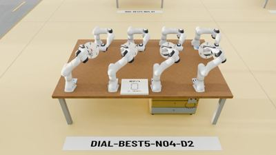</a><br><sub>dial-best5-n04-d2</sub></td><td><a href="https://changxuanfan.github.io/RoboTeam/#task=dial-best5-n06-d2">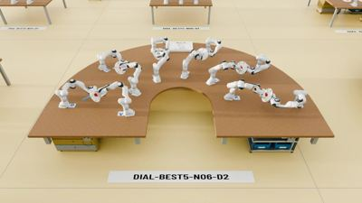</a><br><sub>dial-best5-n06-d2</sub></td><td><a href="https://changxuanfan.github.io/RoboTeam/#task=dial-best5-n08-d2">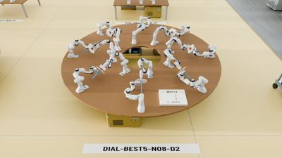</a><br><sub>dial-best5-n08-d2</sub></td></tr><tr><th>L3</th><td><a href="https://changxuanfan.github.io/RoboTeam/#task=dial-best5-n04-d3">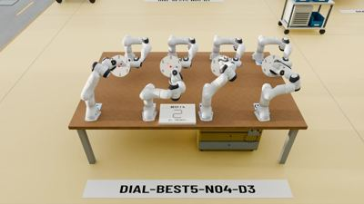</a><br><sub>dial-best5-n04-d3</sub></td><td><a href="https://changxuanfan.github.io/RoboTeam/#task=dial-best5-n06-d3">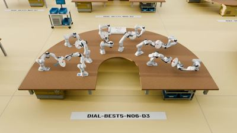</a><br><sub>dial-best5-n06-d3</sub></td><td><a href="https://changxuanfan.github.io/RoboTeam/#task=dial-best5-n08-d3">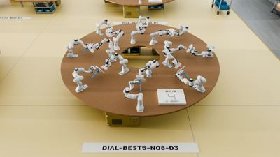</a><br><sub>dial-best5-n08-d3</sub></td></tr></table>
<!-- /gallery -->

</details>

## Getting started

### 1. What you need

| | |
| --- | --- |
| **Host** | macOS on Apple silicon, Linux with an NVIDIA GPU or CPU only, a Slurm cluster, a RunPod pod or Docker. Each has a guide in [docs/hosts/](docs/README.md). |
| **Software** | Python 3.12, [uv](https://docs.astral.sh/uv/), Node.js, `ffmpeg`, and the CLI of the engine you run: Claude Code 2.1.316 (`claude`) or Codex 0.165.0 (`codex`). Other versions are refused. |
| **Linux sandbox** | `bwrap` and `socat` where user namespaces work; otherwise Linux 6.7 or newer (Landlock ABI 4) with `libseccomp`. |
| **A model account** | A Claude subscription token, or an API key for one of the profiles in [`models.json`](models.json). |

### 2. Install

```sh
git clone https://github.com/changxuanfan/RoboTeam.git
cd RoboTeam
uv sync --locked
.venv/bin/roboteam bootstrap
```

`bootstrap` downloads the pinned task assets and checks every file against its hash.

### 3. Credentials

```sh
cp .env.example .env
chmod 600 .env
```

Fill in only the variable your profile reads: `OPENAI_API_KEY` for Codex's default `sol`
(gpt-6.1-sol), `ANTHROPIC_API_KEY` for Claude Code's default `opus` (claude-opus-5-5), or
`CLAUDE_CODE_OAUTH_TOKEN` (from `claude setup-token`) for a Claude subscription profile. Keep credentials in `.env`, not exported in the shell: runs load it themselves and
hand the Claude token to the CLI on a pipe, so no policy shell can read it.

### 4. Choose what to run

Defaults are in [`roboteam.toml`](roboteam.toml): Codex with `sol` (`--engine claude` selects `opus`), the adaptive
protocol, all 36 tasks, and a renderer picked for the host. Change them with options or a
small TOML of your own, passed before the command (`roboteam --config site.toml ...`);
[`docs/hosts/examples/`](docs/hosts/examples) has one for the Mac, RunPod and Slurm.

```sh
.venv/bin/roboteam doctor --engine claude                  # CLI version, sandbox, renderer, credentials
.venv/bin/roboteam plan --engine claude --families relay --level 1
```

`plan` lists each task, its arms and the model, and makes no model calls.

### 5. Build and check the policy environment

Every run gives the model its own frozen Python environment, closed off from the rest of the
host. Build it once per host, in a folder outside your home folder and the repository, then
check that its sandbox holds:

```sh
.venv/bin/python -m scripts.release.build_policy_env --base /Users/Shared/roboteam   # prints its root
.venv/bin/python -m scripts.release.check_policy_env /Users/Shared/roboteam/policy-env-<id>
```

On macOS that base is the default. On Linux pick one (outside `/tmp`) and set
`ROBOTEAM_POLICY_ENV_BASE` to it in the shell that prepares runs. The check starts each
engine's real CLI against a local stub, with no model calls, and tries about 50 things a policy
must and must not be able to do; `prepare` refuses an environment that has not passed it.
[Policy environment](docs/hosts/policy-environment.md) covers what each platform allows.

### 6. Preflight, then run

```sh
.venv/bin/roboteam preflight --engine claude --confirm-spend --max-budget-usd 1
.venv/bin/roboteam prepare --engine claude --families relay --level 1 --output runs/policy/claude-relay-l1
.venv/bin/roboteam run runs/policy/claude-relay-l1
.venv/bin/roboteam status runs/policy/claude-relay-l1
```

- `preflight` makes a few small, paid calls to confirm the model and CLI behave as the harness
  needs; a run is refused without its passed receipt.
- `prepare` freezes the code, the task inputs, the profile and the configuration into a new
  folder. Nothing in it changes afterwards.
- `run` on macOS hands the batch to launchd and returns, so it outlives the terminal; on Linux
  add `--durable` for the same. Each run has 24 hours of active time from its START and is
  scored then, or when the model finishes.
- `stop` ends a batch in order. A run that stopped unexpectedly continues by itself once;
  `roboteam continue` continues stopped runs by hand, as the same trials.

Each run's results, videos and evidence stay in the batch folder; when the batch ends they are
also collected into `runs/exports/<batch>-<hash>/` and a verified ZIP beside it (the runs root
is `paths.runs_root`, default `runs/`). [Getting started](docs/getting-started.md) goes through each step in detail;
[docs/](docs/README.md) has every guide.

## Repository layout

| Path | What is there |
| --- | --- |
| [`benchmark/`](benchmark/README.md) | The 36 released tasks and `release.json` |
| [`roboteam/`](roboteam) | The package: simulation, robot tool, runtime with its sandbox, the Codex and Claude Code adapters, evaluation and analysis |
| [`prompts/`](prompts) | Every text an agent reads: rules, roles and guides |
| [`roboteam.toml`](roboteam.toml), [`models.json`](models.json) | The defaults for new runs and the model profiles ([settings](docs/cli.md#settings-files)) |
| [`scripts/`](scripts/README.md) | Engineering commands: release and policy environment, analysis, project page, tests |
| [`tests/`](docs/development/testing.md) | The test suite |
| [`docs/`](docs/README.md) | Guides by topic |
| [`site/`](site/DESIGN.md) | The project page |
| [`docker/`](docker/Dockerfile) | The container image |

## Citation

```bibtex
@misc{roboteam2026,
  title  = {RoboTeam: Benchmarking Vision-Based Multi-Agent Control of
            Many Robot Arms in Real Time},
  author = {Fan, Changxuan and others},
  year   = {2026},
  url    = {https://github.com/changxuanfan/RoboTeam}
}
```

First author: **Changxuan Fan**, Hong Kong University of Science and Technology. The
remaining author list, publication status and paper URL are not finalized.

## License

Code is under the [MIT License](LICENSE). Benchmark data and media (task and scene data,
rendered images, Robo World scene assets and published videos) are under
[CC BY 4.0](LICENSE-DATA.md). Third-party material keeps its own license: the Franka Panda
model from MuJoCo Menagerie (Apache 2.0), the Barlow Condensed, Space Grotesk and JetBrains
Mono fonts (OFL 1.1) and a Poly Haven texture (CC0); see [`LICENSE-DATA.md`](LICENSE-DATA.md).
